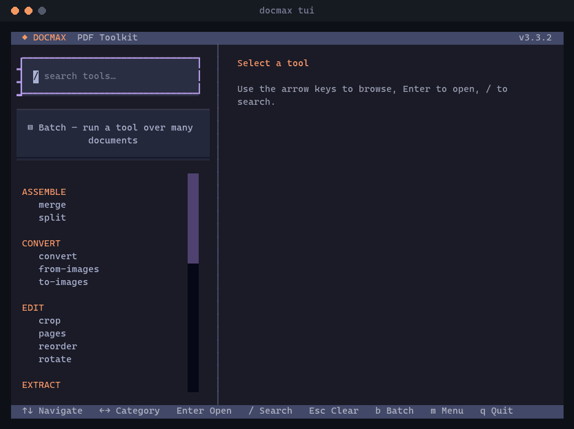

<div align="center">

# DocMax

**Your documents, handled. By your AI assistant, a full-screen app, or a single command.**<br>
Merge, split, compress, OCR, protect and convert PDFs and images from one local engine.<br>
One `pip install`. No Ghostscript, no Poppler, no Docker, no upload.

<p>
  <a href="https://pypi.org/project/Docmax/"></a>
  <a href="https://pypi.org/project/Docmax/"></a>
  <a href="https://github.com/megabyte44/docmax/actions/workflows/ci.yml"></a>
  <a href="LICENSE"></a>
  <a href="https://modelcontextprotocol.io/"></a>
  <a href="https://github.com/megabyte44/docmax/stargazers"></a>
</p>

<p>
  <a href="#-quick-start">Quick start</a> ·
  <a href="#-let-your-ai-assistant-do-it-mcp">AI assistants</a> ·
  <a href="#-or-use-the-full-screen-app">Terminal app</a> ·
  <a href="#-what-you-can-do">Tools</a> ·
  <a href="#-automate-everything">Automation</a> ·
  <a href="#-contributing">Contributing</a> ·
  <a href="CHANGELOG.md">Changelog</a>
</p>


</div>

---

## One engine, four ways in

Every tool is declared once. The command line, the terminal app, AI assistants over MCP and the
HTTP API are all generated from that declaration, so they run the same code and can't drift apart.

What that buys you, whichever door you use:

- **Private by default.** Everything runs on your machine. Nothing is uploaded unless you opt in, per tool.
- **Safe by construction.** Output is staged, checked, then swapped into place atomically. A crash never leaves a half-written PDF.
- **Nothing to set up.** The core tools run on libraries that ship as wheels for macOS, Linux and Windows.
- **Machine-readable.** Every command speaks `--json`, with progress on stderr and results on stdout.

## 🚀 Quick start

```bash
pip install "Docmax[mcp]"
```

Pick your front door:

```bash
docmax mcp connect     # let Claude Desktop, Claude Code or Cursor use DocMax
docmax tui             # open the full-screen app
docmax merge report_q1.pdf report_q2.pdf -o annual_report.pdf   # or just run a command
```

Run `docmax doctor` any time to see what is built in and what is optional on your machine.

## 🤖 Let your AI assistant do it (MCP)

DocMax is a [Model Context Protocol](https://modelcontextprotocol.io/) server. One command wires it into
Claude Desktop, Claude Code and Cursor, and every tool below becomes something your assistant can call:

```bash
pip install "Docmax[mcp]"
docmax mcp connect
```

`connect` starts the server exactly the way your app will and confirms it answers before it writes anything, then reports how many tools it found. Restart the app afterwards. If the tools don't appear, `docmax mcp check` repeats that test and prints whatever the server said.

Then ask your assistant: *"Merge everything in `invoices/`, compress it for email, and tell me the final size."*

The agent only gets what you allow:

- **Folder confinement.** `--root` limits reads and writes to one directory. `..` and symlink escapes are rejected.
- **No overwrites.** `--force` is disabled for agents.
- **No surprise uploads.** The cloud engine is off, and an agent cannot grant consent for you.
- **Cancellation works.** Interrupt a request and the underlying work stops without damaging files.

<details>
<summary>What the config looks like</summary>

```json
{
  "mcpServers": {
    "docmax": {
      "command": "C:\\Python311\\python.exe",
      "args": ["-m", "docmax", "mcp", "--root", "C:\\path\\to\\documents"]
    }
  }
}
```

The command is the full path of the Python that has DocMax installed (`connect` fills it in). A bare `docmax` often works in a terminal and fails in Claude Desktop, because desktop apps do not see your shell's `PATH`.

</details>

## 🖥️ Or use the full-screen app

No flags to remember. Search for a tool, fill in a form, and watch it run. It uses the same engines as
the assistant and the command line, so results are identical.

<div align="center">
  
</div>

```bash
pip install Docmax
docmax tui
```

- **Type to search.** The tool list filters as you type, and each tool shows what it takes and produces.
- **Forms, not flags.** Pick a tool, fill in the fields, and run it, with a **Browse…** button for paths.
- **Batch with live progress.** Press `b` to run one tool over many documents. Every file is listed up front and moves from queued to running to done, with a progress bar, per-file timing and an ETA.
- **Works over SSH.** No browser and no display server needed.

## 🛡️ It refuses to destroy your files

<div align="center">
  
</div>

Most document scripts fail quietly and badly. DocMax was built after watching that happen,
and every guarantee below is backed by an automated test.

| Guarantee | What it means for you |
|---|---|
| **Atomic writes** | Results are written beside the destination, validated, then swapped in. Interrupt it and your target is intact or absent, never half-written. |
| **No in-place clobbering** | `docmax merge a.pdf b.pdf -o a.pdf` is refused before any work starts. |
| **Overwrite needs `--force`** | An existing output is never replaced by accident. |
| **Errors that tell you what to do** | No raw tracebacks. Every known error names the next step. |
| **Clean temp files** | Intermediate files are purged on success, failure and cancel. |

## 🧰 What you can do

Run `docmax --help` for the full list, or `docmax formats` to see what each tool reads and writes.

<details open>
<summary><b>PDF pages and assembly</b></summary>

| Command | What it does |
|---|---|
| `merge` | Combine PDFs in order, keeping bookmarks |
| `split` | One file per page, or by range |
| `rotate` | Rotate all or selected pages by 90, 180 or 270 degrees |
| `pages` | Keep or drop pages and ranges (`1-3,5,7-end`) |
| `reorder` | Rearrange pages by sequence, or visually with `--interactive` |
| `crop` | Trim margins by coordinates, or draw the box with `--interactive` |

</details>

<details open>
<summary><b>Security and inspection</b></summary>

| Command | What it does |
|---|---|
| `protect` | Encrypt with AES-256 or AES-128 and set permissions |
| `unlock` | Write a copy with the password removed |
| `permissions` | Show what a PDF lets a reader do |
| `sanitize` | Strip JavaScript, embedded files, hidden annotations and auto-actions |
| `metadata` | Read or edit title, author, subject, keywords |
| `get-info` | Page count, size, encryption, metadata |

</details>

<details open>
<summary><b>Enhance and convert</b></summary>

| Command | What it does | Engine |
|---|---|:---:|
| `ocr` | Searchable PDFs with Tesseract, optional auto-deskew, language selection | Local / Cloud |
| `compress` | Recompress images and structure with quality presets | Local / Cloud |
| `convert` | Markdown/HTML to HTML and TXT built in. Word, ODT, LaTeX, EPUB, RST via Pandoc | Local / Cloud |
| `watermark` | Text watermark with opacity, rotation and nine anchor positions | Local |
| `stamp` | Overlay another PDF's first page, such as a letterhead | Local |
| `to-images` | Render pages to PNG, JPEG or TIFF | Local |
| `from-images` | Build a PDF from images, one page each | Local |

</details>

<details>
<summary><b>Images</b></summary>

| Command | What it does |
|---|---|
| `compress-image` | Shrink JPEG, PNG and WebP |
| `convert-image` | Convert between PNG, JPEG, WebP, TIFF and BMP |
| `resize` | Scale by size, factor or fit |
| `remove-bg` | Remove a background with `rembg` |
| `watermark-image` | Draw semi-transparent text on an image |

</details>

### What needs extra installs?

`pip install Docmax` includes the CLI, the TUI, the image tools, AES encryption and OCR
deskewing. Only the heavy or niche pieces are opt-in:

```bash
pip install "Docmax[tables]"     # table extraction
pip install "Docmax[remove-bg]"  # background removal
pip install "Docmax[mcp]"        # AI assistant server
pip install "Docmax[all]"        # everything above except mcp and server
```

(`Docmax[tui]`, `[images]`, `[crypto]` and `[ocr]` still work; they are already included.)

Two optional programs add capability. Both have a cloud fallback via `--engine cloud`:

| Program | Unlocks | Install |
|---|---|---|
| **Tesseract** | local `ocr` | `docmax setup ocr` |
| **Pandoc** | `convert` to and from Word, ODT, LaTeX, EPUB, RST | `docmax setup convert` |

> PyMuPDF does the rendering and compression. It is AGPL-3.0 (commercial licences are available
> from Artifex) and is installed alongside DocMax, not bundled. Read its licence before
> redistributing a product built on top of this.

## ⚙️ Automate everything

### Pipelines: chain tools in one file

```toml
# clean_scan.toml
name = "clean-scan"

[[stage]]
tool = "ocr"
params = { lang = "eng", dpi = 300 }

[[stage]]
tool = "compress"
params = { preset = "ebook" }

[[stage]]
tool = "watermark"
params = { text = "CONFIDENTIAL", opacity = 0.2, position = "center" }
```

```bash
docmax pipeline scan.pdf --pipeline clean_scan.toml -o final.pdf
```

Stages write to an isolated sandbox. If stage three fails, your destination is untouched.

### Batch: hundreds of files, one bad apple doesn't stop the run

```bash
docmax batch incoming/*.pdf --output-dir processed/ --tool ocr
```

If file 14 is corrupt it is reported with a structured error and the other 199 finish.

### Watch: process files as they land

```bash
docmax watch ~/Downloads/Scans --output-dir ~/Documents/Archive --tool ocr
```

Files are picked up only after their size stops changing, and the output folder can't overlap the watched one.

### JSON for scripts and CI

```bash
docmax get-info sample.pdf --json
```

```json
{"ok": true, "result": {"name": "sample.pdf", "size_bytes": 245120, "encrypted": false, "pages": 12, "metadata": {"/Producer": "pypdf"}}}
```

Error codes are stable public API, so you can branch on them safely.

## 🔒 Local first, cloud only if you say so

Every tool has a local engine. Heavy operations (`compress`, `convert`, `ocr`) can optionally run on
a self-hosted or remote Cloud Engine instead:

```bash
docmax ocr scan.pdf --engine local   # force offline
docmax ocr scan.pdf --engine cloud   # opt in to the cloud engine
```

Nothing is sent without consent, which you grant per tool with `docmax cloud agree` and can revoke
at any time. Setting `offline = true` in your config disables all network traffic regardless of flags.
See [docs/cloud-api.md](docs/cloud-api.md) for the API.

## 🆚 How it compares

| | **DocMax** | Web PDF tools | Shell scripts |
|---|:---:|:---:|:---:|
| Install | `pip install` | none, but you upload files | Ghostscript + Poppler + Pandoc + `PATH` fixes |
| Your files stay on your machine | ✅ | ❌ | ✅ |
| Same behaviour on macOS, Linux, Windows | ✅ | ✅ | ❌ |
| Safe against crashes mid-write | ✅ | varies | ❌ |
| Works over SSH / headless | ✅ | ❌ | ✅ |
| `--json` output | ✅ | ❌ | DIY |
| Lets an AI assistant drive it | ✅ built in | ❌ | DIY |

## 🏗️ How it's built

Each tool is declared once, in a `ToolSpec`. The CLI, TUI, HTTP server and MCP server are all
**generated** from that declaration, so a new tool shows up everywhere without touching an interface.
The layering is enforced by `import-linter`, and the rules that keep it honest are tests, not
conventions.

```
 CLI · TUI · HTTP server · MCP        ← generated from the registry
              │
         EngineRouter                 ← picks local or cloud, one code path
              │
       Tools (ToolSpec + strategy)    ← declared once
              │
      core: atomic writes, typed errors
```

Read more: [Architecture overview](docs/architecture/overview.md) ·
[Decision records](docs/adr/README.md) · [Implementation guides](docs/implementation/core.md) ·
[Migrating from v2](docs/migrating-from-v2.md)

## 🤝 Contributing

Contributions are welcome, from typo fixes to new tools. See [CONTRIBUTING.md](CONTRIBUTING.md) for
the full guide. The short version:

```bash
git clone https://github.com/megabyte44/docmax.git
cd docmax
python -m venv .venv && source .venv/bin/activate   # Windows: .venv\Scripts\activate
pip install -e ".[dev]"

pytest && ruff check . && ruff format --check . && mypy && lint-imports
```

Good places to start: pick an issue labelled `good first issue`, add a tool by copying
`src/docmax/tools/merge/`, or improve an error message's `remedy`.

Found a vulnerability? Please follow [SECURITY.md](SECURITY.md) instead of opening a public issue.

## ⭐ Support the project

If DocMax saved you an afternoon, a star helps other people find it.

[](https://star-history.com/#megabyte44/docmax&Date)

## License

[MIT](LICENSE). Third-party components keep their own licences, notably PyMuPDF (AGPL-3.0).
